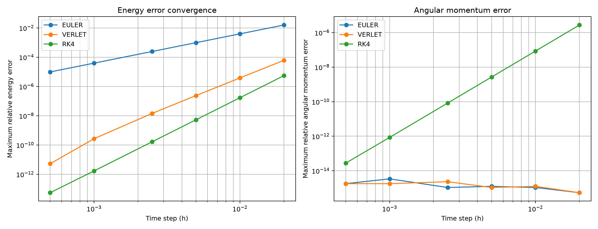
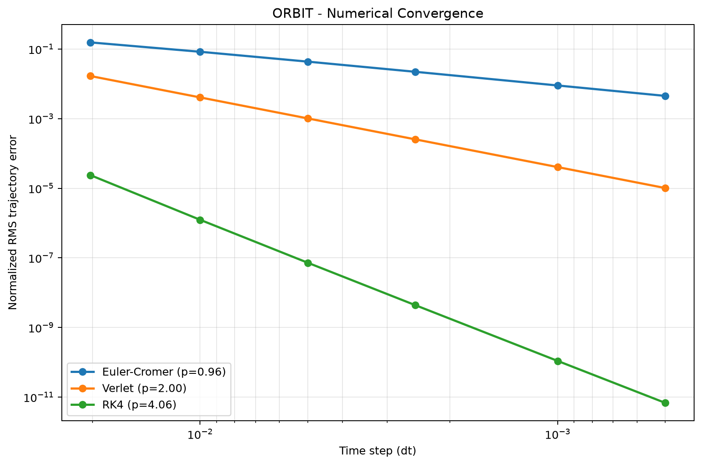
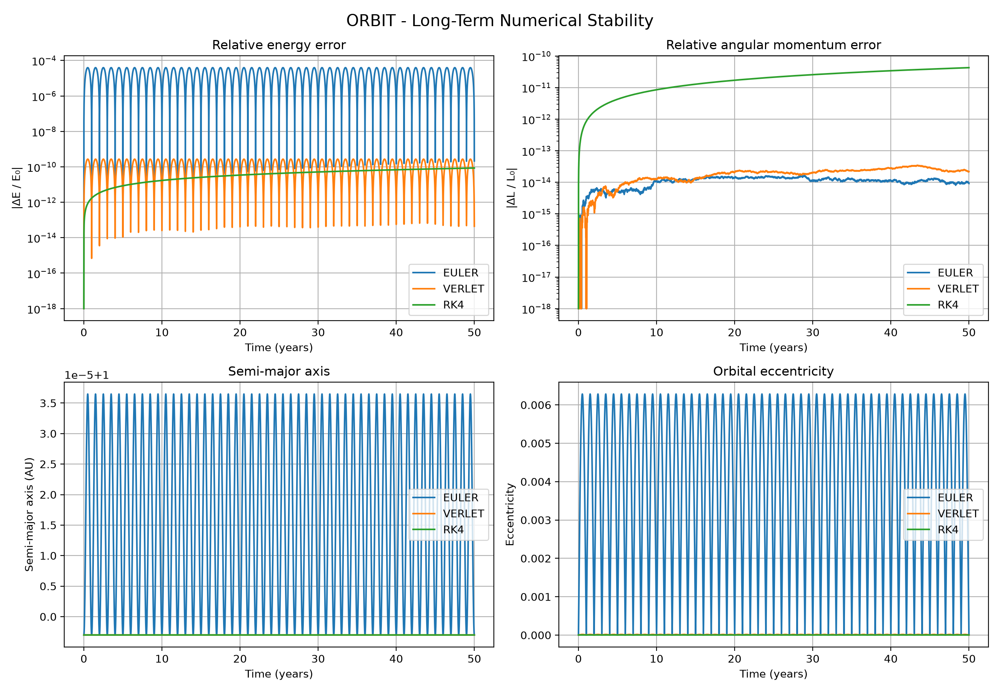

# ORBIT — Gravitational Mechanics Simulator

ORBIT is a two-dimensional gravitational mechanics simulator developed in Python. It models the motion of interacting celestial bodies using Newton's law of universal gravitation and compares three numerical integration methods.

The project combines classical mechanics, numerical analysis, scientific visualization, and an interactive graphical interface.

## Visual overview

### Numerical integrator comparison



### Numerical convergence



### Orbital diagnostics



## Table of contents

- [Features](#features)
- [Physical model](#physical-model)
- [Numerical integration methods](#numerical-integration-methods)
- [Numerical results](#numerical-results)
- [Installation](#installation)
- [Running the simulator](#running-the-simulator)
- [Scientific experiments](#scientific-experiments)
- [Project structure](#project-structure)
- [Limitations](#limitations)
- [Technologies](#technologies)
- [AI assistance](#ai-assistance)

## Features

- Interactive graphical interface built with Tkinter and Matplotlib.
- Solar-system and three-body simulation scenarios.
- Animated orbital trajectories.
- Individual simulations and integrator comparisons.
- Three numerical integration methods:
  - Euler-Cromer
  - Velocity Verlet
  - Fourth-order Runge-Kutta (RK4)
- Mechanical energy and angular momentum diagnostics.
- Orbital element analysis.
- Numerical accuracy and convergence experiments.
- CSV data exports and scientific plots.

## Physical model

The simulator uses Newton's law of universal gravitation. The magnitude of the gravitational force between two point masses is:

\[
F = G\frac{m_1m_2}{r^2}
\]

For a system of multiple bodies, the acceleration of body \(i\) is calculated by summing the gravitational contributions of every other body:

\[
\mathbf{a}_i =
G\sum_{j\ne i}
m_j
\frac{\mathbf{r}_j-\mathbf{r}_i}
{\|\mathbf{r}_j-\mathbf{r}_i\|^3}
\]

The equations of motion are integrated numerically over discrete time steps. The resulting trajectories are analyzed using mechanical energy, angular momentum, and position error.

Two simulation scenarios are available:

- **Sun-Earth:** an idealized two-body system using astronomical units and years.
- **Three-body:** an equal-mass figure-eight periodic solution using normalized units.

## Numerical integration methods

| Method | Order | Main characteristic |
|---|---:|---|
| Euler-Cromer | 1 | Simple symplectic method |
| Velocity Verlet | 2 | Good long-term energy behavior |
| RK4 | 4 | High accuracy per integration step |

The methods are compared in terms of trajectory accuracy, conservation properties, and convergence as the time step decreases.

## Numerical results

A one-year Sun-Earth experiment compares each integration method against a finer-step RK4 reference solution.

| Method | RMS position error | Maximum relative energy drift |
|---|---:|---:|
| Euler-Cromer | \(1.112376\times10^{-2}\) | \(1.579208\times10^{-4}\) |
| Velocity Verlet | \(1.584805\times10^{-4}\) | \(5.758712\times10^{-9}\) |
| RK4 | \(1.765598\times10^{-9}\) | \(5.470135\times10^{-11}\) |

The convergence experiment produced the following estimated orders:

| Method | Measured order | Expected order |
|---|---:|---:|
| Euler-Cromer | 0.9604 | 1 |
| Velocity Verlet | 2.0019 | 2 |
| RK4 | 4.0647 | 4 |

These results are numerical estimates obtained under the experiments' chosen initial conditions, time steps, and reference solutions. They are not universal performance guarantees. The reference solution is itself a numerical approximation.

## Installation

Requirements:

- Python 3
- NumPy
- Matplotlib
- Tkinter

Clone the repository:

```bash
git clone https://github.com/msk-29/ORBIT.git
cd ORBIT
```

Create and activate a virtual environment:

```bash
python -m venv .venv
source .venv/bin/activate
```

On Windows, activate it with:

```powershell
.venv\Scripts\activate
```

Install the dependencies:

```bash
python -m pip install -r requirements.txt
```

If Tkinter is not available in your Python installation, install the corresponding system package for your operating system.

## Running the simulator

Launch the graphical application:

```bash
python app.py
```

Select a simulation scenario, choose an integration method, configure the time step and duration, and run the simulation.

The application also supports comparing all three integration methods.

## Scientific experiments

The project includes independent scripts for numerical analysis:

```bash
python experiment.py
python diagnostics.py
python convergence.py
python analysis_metrics.py
```

Each experiment generates CSV data and scientific plots for further inspection.

| Script | Purpose |
|---|---|
| `experiment.py` | Compares integration methods across different time steps |
| `diagnostics.py` | Evaluates energy, angular momentum, and orbital elements |
| `convergence.py` | Estimates numerical convergence order |
| `analysis_metrics.py` | Measures trajectory accuracy against a reference solution |

## Project structure

| File | Description |
|---|---|
| `orbit.py` | Gravitational model, system definitions, and numerical integrators |
| `visualizer.py` | Orbital animation and visualization |
| `app.py` | Interactive graphical application |
| `experiment.py` | Numerical comparison experiments |
| `diagnostics.py` | Conservation and orbital diagnostics |
| `convergence.py` | Convergence analysis |
| `analysis_metrics.py` | Accuracy metrics and reference comparison |
| `requirements.txt` | Python dependencies |

## Limitations

- Simulations are restricted to two spatial dimensions.
- The gravitational model is Newtonian.
- Celestial bodies are treated as point masses.
- The Sun-Earth scenario is an idealized two-body model, not a complete Solar System simulation.
- Numerical reference solutions are approximations rather than exact analytical solutions.
- Relativistic effects and non-gravitational forces are not modeled.

## Technologies

- Python
- NumPy
- Matplotlib
- Tkinter
- CSV
- Git and GitHub

## AI assistance

OpenAI ChatGPT was used during development for implementation assistance, debugging, documentation, and numerical analysis. The author is responsible for reviewing and understanding the project's code, methods, and results.

## Author

Developed as a CS50 final project.

**Repository:** https://github.com/msk-29/ORBIT
